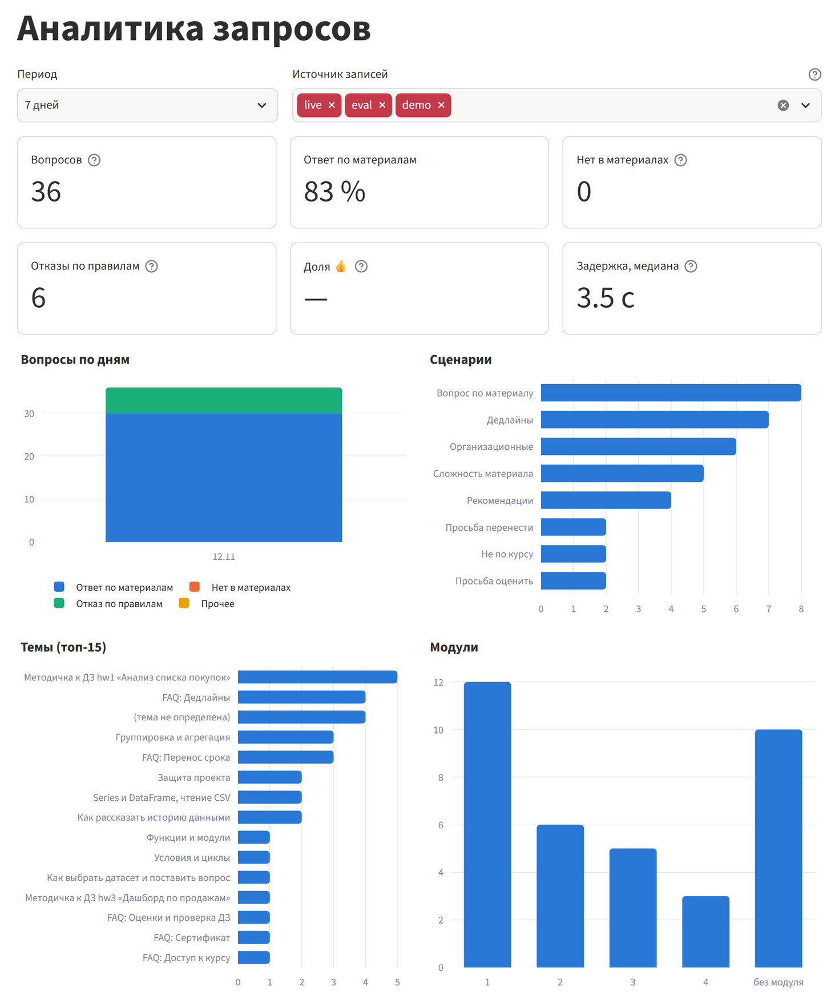
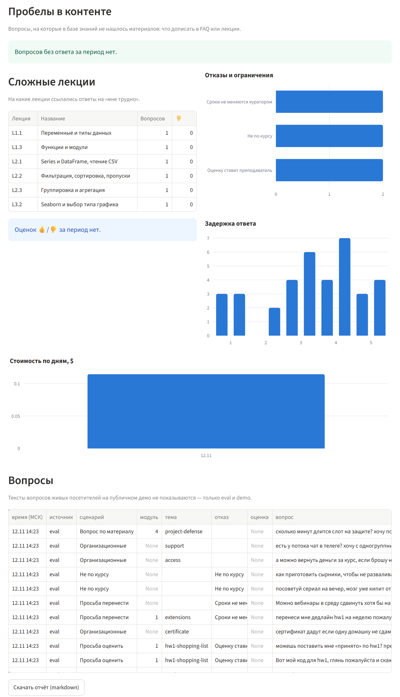

# Логирование запросов и аналитика по темам

Каждый вопрос к куратору оставляет обезличенную запись в журнале SQLite. Из журнала строятся дашборд
(страница «Аналитика» в Streamlit) и markdown-отчёт по темам для преподавателя и методиста. Задача аналитики —
показать, о чём спрашивают, где база знаний не отвечает и какие лекции даются трудно, чтобы улучшать контент.

Код: `curator/journal.py` (журнал), `curator/analytics.py` (расчёты), `curator/report.py` (отчёт),
`app/views/1_Аналитика.py` (дашборд), `curator/privacy.py` (обезличивание).

## 1. Что и когда пишется в журнал

Запись делает `Curator.ask` на каждый вопрос, в том числе на отказы по лимитам демо, фиксированные ответы
(оценка, перенос, не по курсу) и ответы при сбоях сервисов. Оценку 👍/👎 интерфейс дописывает в ту же запись.
Сбой записи не мешает ответу: ответ показывается, ошибка уходит в лог службы.

Файл журнала — `data/journal.db` (переменная `CURATOR_JOURNAL`; на сервере `/var/lib/ai-curator/journal.db`).
Прогоны оценки пишут свой журнал `eval/runs/<прогон>/journal.db`, живой журнал они не трогают. На сервер журналы
прогонов не выкладываются: на публичном демо «Аналитика» показывает только вопросы посетителей и кнопок-примеров.
Как дашборд выглядит на журнале прогона оценки — скриншоты в разделе 6.

Поле `source` разделяет записи:

| `source` | Откуда |
|---|---|
| `live` | вопрос, набранный в чате (посетитель демо) |
| `demo` | кнопка-пример в чате («Когда дедлайн второго ДЗ и сколько осталось?» и др.) |
| `eval` | прогон оценки (`eval/run_eval.py`) |

### Поля записи

| Поле | Что хранит |
|---|---|
| `id` | номер записи |
| `ts` | время записи, UTC, ISO 8601 с миллисекундами (`2026-11-12T09:15:02.123Z`) |
| `session` | код сессии: HMAC-SHA256 идентификатора сессии с секретной солью, 16 знаков (раздел 2) |
| `source` | `live`, `eval` или `demo` |
| `question` | вопрос после обезличивания; у отказа по лимиту — первые 300 знаков |
| `intent` | сценарий: `deadline`, `difficulty`, `material`, `recommendation`, `organizational`, `grading_request`, `schedule_change`, `off_topic`; у отказа по лимиту пусто. `off_topic` пишется и тогда, когда анализ выбрал сценарий ответа по материалам, но поиск ничего не нашёл, а в вопросе признак темы не о курсе |
| `module` | модуль, по которому искали (1-4) или пусто |
| `topic` | тема (slug из базы знаний) или пусто |
| `level` | уровень ответа: `beginner` или `advanced` |
| `level_source` | откуда уровень: `manual` (выбран в интерфейсе), `hint` (по вопросу), `student` (уровень демо-студента), `default` |
| `analysis_method` | кто разобрал вопрос: `llm` или `rules` (модель анализа не ответила) |
| `guard` | правило, которое изменило сценарий или ответ, или пусто: `difficulty->schedule_change` и т. п. (явная просьба в вопросе перебила сценарий модели анализа); `grading_request->organizational`, `schedule_change->organizational`, `schedule_change->deadline` — из `grading_request` или `schedule_change` в `organizational` или `deadline` (обратная поправка: модель назвала вопрос о правилах курса просьбой, а просьбы в нём нет — [architecture.md](architecture.md), раздел 5.1); `output:grading_request` или `output:schedule_change` (ответ модели с обещанием оценки или переноса заменён шаблоном); `output:revision_deadline` (из ответа модели вырезан срок доработки, названный датой или «осталось N», в конец добавлено правило доработки); `output:duration` (из рекомендации вырезана длительность «около N минут», которой нет в материалах). Две последние поправки — не отказ: ответ остаётся ответом по материалам. Несколько поправок пишутся через запятую, сначала поправка анализа: `grading_request->organizational,output:grading_request`, `output:revision_deadline,output:duration` |
| `sources` | JSON показанных источников: `[{"kind": "lecture", "id": "L2.3", "section": "Как работает groupby"}]` |
| `doc_ids` | id источников через запятую — для быстрых выборок |
| `n_sources` | число показанных источников |
| `cited` | модель сама сослалась хотя бы на один источник (у шаблонных ответов — 0) |
| `answered` | ответ опирается на материалы курса; у отказов и сбоев — 0 |
| `refusal` | код отказа или пусто (таблица ниже) |
| `top_score` | лучшая косинусная близость найденного фрагмента (без прибавки за фильтр анализа) |
| `filter` | самый узкий фильтр из цепочки поиска, в который укладывается вся выдача: `модуль 2, тип guide/faq`, `модуль 4` или `без фильтра` |
| `relaxed` | в выдаче есть фрагменты вне запрошенного фильтра (выбор в интерфейсе + анализ запроса): фрагмент вне фильтра анализа оказался заметно ближе к вопросу, в фильтре нашлось меньше 5 фрагментов или фильтр интерфейса пришлось ослабить. Фильтр анализа — приоритет, а не стена ([architecture.md](architecture.md), раздел 6.6), поэтому `relaxed=1` — частое и нормальное значение |
| `latency_ms` | время от получения вопроса до готового ответа, мс |
| `prompt_tokens`, `completion_tokens` | токены анализа запроса и ответа вместе |
| `cost_usd` | стоимость токенов по ценам из настроек (`PRICE_INPUT_PER_1M`, `PRICE_OUTPUT_PER_1M`); эмбеддинги не входят |
| `rating` | оценка ответа: `1` (👍), `-1` (👎) или пусто |
| `model` | модель ответа |
| `kb_version` | версия базы знаний: хеш файлов из манифеста индекса |
| `student_used` | в ответе использованы данные выбранного демо-студента (сам id студента не пишется) |

### Коды отказов (`refusal`)

| Код | Что случилось | Подпись на дашборде |
|---|---|---|
| `grading_request` | просьба оценить: фиксированный ответ | Оценку ставит преподаватель |
| `schedule_change` | просьба перенести: фиксированный ответ | Сроки не меняются куратором |
| `off_topic` | вопрос не о курсе (в том числе когда поиск ничего не нашёл, а в вопросе признак темы не о курсе) | Не по курсу |
| `small_talk` | приветствие, благодарность или «понятно», «ок» без вопроса | Приветствие / благодарность |
| `output_guard` | ответ модели обещал оценку или перенос и заменён фиксированным | Ответ модели заменён (ограничение) |
| `no_context` | в материалах нет фрагментов выше порога близости | Нет в материалах |
| `search_error` | поиск по базе знаний не ответил | Поиск по материалам не ответил |
| `llm_error` | модель ответа не ответила или вернула пустой текст | Модель не ответила |
| `limit_too_long`, `limit_per_hour`, `limit_hourly`, `limit_daily`, `limit_empty` | лимиты демо: длинный вопрос, вопросов в час на посетителя, общий в час, дневной, пустой вопрос | Лимит: … |

## 2. Обезличивание

**Код сессии вместо идентификатора.** Идентификатор сессии в Streamlit случайный и новый на каждый «Новый
диалог» и перезагрузку страницы. В журнал идёт его HMAC-SHA256 с секретной солью `USER_HASH_SALT` (16 знаков):
по коду видно реплики одного диалога, но не человека. На сервере соль создаётся один раз при первой выкладке
и потом не меняется; без соли она случайная на каждый запуск, и коды после перезапуска другие.

**Вычистка вопроса** (`privacy.redact`) — до отправки в OpenAI, до памяти диалога и до журнала:

| Что | Замена |
|---|---|
| адрес почты (кроме публичных контактов курса: `support@academy-data.example`) | `[почта]` |
| ссылка `t.me/…`, `telegram.me/…`, ник `@name` (кроме переменной после оператора сравнения или `in` в строке `pandas.query`: «qty >= @limit») | `[ник]` |
| паспорт (серия и номер; слово «серия» — только с цифрами паспорта сразу после него), СНИЛС | `[документ]` |
| имя после «меня зовут», «моё имя», «моя фамилия» (1-3 слова, в том числе со строчной буквы; служебные слова вроде «не помню» именем не считаются) | `[имя]` |
| телефоны, номера карт и счетов — 7 и больше цифр | `[номер]` |

Даты («15.11.2026 23:59» и ISO — «2026-11-12», «2026-11-01 2026-11-15», «2026-11-12 14:00»), суммы с разрядами
(«1 500 000 рублей»), количество строк данных и без разрядов («1200000 строк», «250000 пропусков», «записей»,
«значений», «заказов»), годы («2019-2026») и десятичные числа номерами не считаются. Внутри кода (`` `…` ``
и блоки ```` ``` ````) длинные числа не трогаются — это вывод программ, — но мобильный номер вида +7 9xx … или
8 9xx … вырезается и там. Исключения для дат ISO, числа строк, переменной `@limit` и слова «серия» нужны потому,
что код студенты часто вставляют без обратных кавычек: иначе модель отвечала бы на испорченный вопрос
(«pd.to_datetime('[номер]')»). Номер карты без разрядов перед «руб» — по-прежнему `[номер]`.

**Что не хранится вовсе:** текст ответа куратора, исходный (необезличенный) вопрос, id демо-студента, адрес
посетителя. Адрес нужен только почасовому лимиту: он хешируется той же солью и живёт в памяти процесса. Из заголовков
`Cf-Connecting-Ip` / `X-Forwarded-For` адрес берётся, только если соединение пришло от доверенного прокси
(`CURATOR_TRUSTED_PROXIES`, на сервере — cloudflared из соседнего контейнера), иначе — адрес соединения
([architecture.md](architecture.md), раздел 5.5). Память
диалога (последние 2 реплики) тоже живёт только в памяти процесса: сессия забывается через час молчания и при
перезапуске.

**Ограничение.** Имя без подсказки («Иван Петров, когда дедлайн?») правилами не распознать. Такие записи покрывает
срок хранения журнала.

## 3. Хранение 90 дней

Записи старше `RETENTION_DAYS` (90 дней) удаляются:

- приложением — при записи в журнал, не чаще раза в час (первый раз — при первом вопросе после запуска);
- на сервере — таймером systemd `ai-curator-cleanup.timer`, ежедневно в 03:50 по времени сервера
  (служба `ai-curator-cleanup.service` запускает `python -m curator.journal cleanup`);
- вручную:

```bash
python -m curator.journal cleanup            # удалить записи старше RETENTION_DAYS
python -m curator.journal cleanup --days 30  # другой срок
python -m curator.journal stats --days 7     # сколько записей по источникам: {"days": 7, "by_source": {...}}
```

`stats` и отчёт открывают журнал только для чтения: если файла нет по указанному пути, команда завершается
с понятной ошибкой, а не создаёт пустую базу и не печатает отчёт из нулей.

## 4. Как считается аналитика

Все показатели считает `curator/analytics.py` из записей журнала, на чистом Python.

- **Период** — последние N дней по настоящим часам: `[сейчас − N дней, сейчас)`. Переменная `CURATOR_NOW` (демо-дата
  курса) на период не влияет: журнал пишет настоящее время. Дни в разрезах — по Москве.
- **Вопрос** — запись, дошедшая до куратора; отказы по лимитам демо в вопросы не входят и считаются отдельно.
- **Ответ по материалам** — `answered=1` и нет отказа. Отказ по правилам (оценка, перенос) ответом не считается.
- **Пробел в контенте** — вопрос с `refusal=no_context`: поиск не нашёл материалов выше порога близости, значит,
  в базу стоит дописать FAQ или раздел лекции. Вопрос, по которому поиск ничего не нашёл, но в нём признак темы
  не о курсе («посоветуй сериал»), пробелом не считается: он записан как `off_topic`.
- **Отказы по правилам** — `grading_request`, `schedule_change`, `off_topic`, `output_guard`.
- **Сложные лекции** — лекции, на которые ссылались ответы в сценарии `difficulty` («мне трудно»), и число 👎 у этих
  ответов.
- **Исход вопроса** (для графика по дням, категории не пересекаются): «Ответ по материалам», «Нет в материалах»,
  «Отказ по правилам», «Прочее» (приветствия, сбои модели и поиска).
- **Задержка** — медиана и 95-й перцентиль (линейная интерполяция, как `numpy.quantile`).
- **Стоимость** — сумма `cost_usd`: анализ запроса и ответ, без эмбеддингов.
- **Сессии** — число разных кодов сессий, то есть диалогов, а не людей.

## 5. Отчёт по темам

```bash
python -m curator.report --days 7                          # в консоль
python -m curator.report --days 30 --out report.md --source live
python -m curator.report --days 7 --include-live-texts     # с примерами вопросов живых студентов (обезличенными)
```

| Параметр | Значение |
|---|---|
| `--days` | период в днях, по умолчанию 7 |
| `--source` | источники через запятую: `live,eval,demo` (по умолчанию все) |
| `--out` | файл `.md`; без него отчёт печатается в консоль |
| `--include-live-texts` | показать в разделе «Пробелы в контенте» примеры вопросов `live`; без флага — только `eval` и `demo` |

Тот же отчёт скачивается кнопкой «Скачать отчёт (markdown)» внизу дашборда — за выбранный там период и источники.

### Структура отчёта

Шапка: период (МСК), сколько записей по каждому источнику, какие источники вошли в отчёт, показаны ли тексты
живых студентов. Дальше 10 разделов:

| № | Раздел | Содержимое |
|---|---|---|
| 1 | Сводка | вопросов; сессий; доля ответов по материалам; без ответа в материалах; отказы по ограничениям; срабатывания лимитов демо; оценок и доля 👍; задержка (медиана и p95); токены и стоимость; доля анализа правилами |
| 2 | Темы | по каждой теме: slug, название (у тем FAQ — «FAQ: Перенос срока» и т. п.), модуль, вопросов, без ответа, «трудно», 👎; по убыванию числа вопросов |
| 3 | Сценарии | по каждому intent: вопросов, доля ответов по материалам, 👎 |
| 4 | Модули | по модулю: вопросов, без ответа |
| 5 | Пробелы в контенте | вопросы, где поиск не нашёл материалов выше порога близости: тема, модуль, число, до 3 примеров (тексты `live` скрыты, если нет флага) |
| 6 | Сложные лекции | лекции из ответов «мне трудно»: id, название, вопросов, 👎; топ-10 |
| 7 | Отказы и ограничения | причина, код, сколько — включая лимиты демо и сбои |
| 8 | Оценки ответов | по сценариям: 👍, 👎, доля 👍 |
| 9 | Задержка и стоимость по дням | день, вопросов, с ответом, без ответа, отказы, стоимость |
| 10 | Что сделать с контентом | рекомендации по правилам (ниже) |

Раздел 10 строится правилами по цифрам отчёта, без модели:

- до 3 тем с вопросами без ответа → «дополнить FAQ или лекцию и пересобрать индекс (`python -m curator.ingest`)»;
- до 2 лекций с вопросами «трудно» → «проверить объяснение и раздел «Если сложно»»;
- до 3 тем с двумя и больше 👎 → «просмотреть ответы куратора по ней»;
- больше 10 % запросов разобраны правилами → «проверить доступность OpenAI и таймауты»;
- сработали лимиты демо → «если это живые студенты, пересмотреть лимиты»;
- ничего из этого → «Явных пробелов не видно».

Фрагмент отчёта по журналу пробного прогона оценки (`eval/runs/sample-1/journal.db`, 3 вопроса; часть строк
опущена):

```markdown
# Отчёт ИИ-куратора: вопросы студентов за 7 дн.

Период: 05.11.2026 11:53 — 12.11.2026 11:53 (МСК). Записей по источникам: live 0, eval 3, demo 0. Вопросы
обезличены; тексты живых студентов не показываются — только eval/demo.

## 1. Сводка

| Показатель | Значение |
|---|---|
| Вопросов | 3 |
| Ответ по материалам курса | 67 % |
| Отказы по ограничениям (оценка, перенос, не по курсу) | 1 |
| Задержка: медиана / p95 | 2.6 с / 6.5 с |
| Токены / стоимость | 14774 / $0.0066 |
…

## 2. Темы

| Тема | Название | Модуль | Вопросов | Без ответа | «Трудно» | 👎 |
|---|---|---|---|---|---|---|
| deadlines | FAQ: Дедлайны | 1 | 1 | 0 | 0 | 0 |
| pandas-groupby | Группировка и агрегация | 2 | 1 | 0 | 0 | 0 |
…
```

Чтобы посмотреть отчёт или дашборд по журналу прогона оценки, укажите его путь. Период считается от настоящего
времени, поэтому для прогона старше недели берите 30 или 90 дней:
`CURATOR_JOURNAL=eval/runs/sample-1/journal.db python -m curator.report --days 90`.

## 6. Дашборд

Страница «Аналитика» (`app/views/1_Аналитика.py`) не требует ключа OpenAI и индекса: она читает только журнал.

Так она выглядит на журнале прогона оценки `eval/runs/dev-3` (36 вопросов рабочего набора, `source=eval`; запуск —
`CURATOR_JOURNAL=eval/runs/dev-3/journal.db streamlit run app/streamlit_app.py`, период 30 или 90 дней, если прогон
старше недели):





- **Фильтры:** период 7, 30 или 90 дней; источники записей (`live`, `eval`, `demo`).
- **KPI** (6 плиток): вопросов (в подсказке — сессий), ответ по материалам, нет в материалах, отказы по правилам,
  доля 👍 (в подсказке — число оценок), задержка — медиана (в подсказке — стоимость за период).
- **Вопросы по дням** — столбцы с накоплением по исходу (ответ по материалам, нет в материалах, отказ по правилам,
  прочее).
- **Сценарии** — вопросов по intent.
- **Темы (топ-15)** — по названию темы, slug — в подсказке.
- **Модули** — вопросов по модулю, в подсказке — без ответа.
- **Пробелы в контенте** — таблица: тема, модуль, вопросов, примеры.
- **Сложные лекции** — таблица: лекция, название, вопросов, 👎.
- **Отказы и ограничения** — сколько каких отказов.
- **Оценки ответов по сценариям** — 👍 и 👎.
- **Задержка ответа** — гистограмма, секунды.
- **Стоимость по дням**, $.
- **Вопросы** — последние 50 вопросов, тексты которых можно показывать (раздел 7): время, источник, сценарий,
  модуль, тема, отказ, оценка, вопрос.
- **Скачать отчёт (markdown)** — отчёт раздела 5 за выбранный период.

Если за период записей нет — подсказка, как наполнить журнал. Если до куратора не дошёл ни один вопрос, а в журнале
только отказы по лимитам демо (например, один слишком длинный вопрос на свежем демо), графиков нет: страница
показывает таблицу этих отказов.

## 7. Приватность живых вопросов

На публичном демо тексты вопросов живых посетителей не показываются — только агрегаты:

- по умолчанию (`SHOW_LIVE_TEXTS=0`) таблица «Вопросы» показывает только тексты `eval` (прогоны оценки) и `demo`
  (фиксированные кнопки-примеры): живые вопросы не выводятся, об этом говорит подпись над таблицей; в «Пробелах
  в контенте» вместо скрытых живых примеров — строка «(ещё N — тексты живых посетителей скрыты)»;
- числа по темам, сценариям, модулям и дням считаются по всем записям, включая `live`;
- отчёт из консоли показывает живые тексты только с явным флагом `--include-live-texts`, отчёт с дашборда — только
  если включён `SHOW_LIVE_TEXTS`;
- даже показанные тексты уже обезличены (раздел 2).

`SHOW_LIVE_TEXTS=1` имеет смысл только для закрытой установки, где дашборд видят преподаватель и методист.

## 8. На сервере

Пути службы (журнал, индекс, выгрузки, адрес LMS) и адрес доверенного прокси (`CURATOR_TRUSTED_PROXIES`) лежат
в несекретном файле `/etc/ai-curator.paths.env`, его подключают все юниты systemd. Команды вручную должны брать те же пути, иначе отчёт будет искать журнал не там:

```bash
cd /opt/ai-curator && set -a && . /etc/ai-curator.paths.env && set +a
.venv/bin/python -m curator.report --days 7 --out /tmp/report.md
.venv/bin/python -m curator.journal stats --days 7
```
